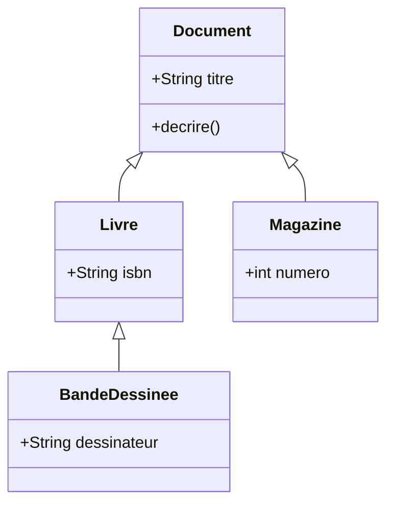

# Guide pédagogique : covariance, contravariance, `extends` et `super` en Java

Ce guide vous donne une compréhension précise de quatre notions, avec une règle de décision à la fin : **où et quand les appliquer**.

Chaque notion renvoie à du code (`src/main/java`) et à un test qui la **prouve** (`src/test/java`). Lancez `mvn verify` et lisez les tests : les tests de la classe `RefusCompilationTest` démontrent par la compilation ce que Java accepte ou refuse.

---

## 1. Le point de départ : la sous-typation

Notre domaine de médiathèque forme une hiérarchie :



On écrit `Livre <: Document` (« un Livre est un Document »). Ce lien est acquis : on peut passer un `Livre` là où un `Document` est attendu.

**La vraie question de ce guide** : que devient ce lien quand le type est **à l'intérieur** d'un autre type, comme `List<Livre>` ?

Soit `C<T>` un type générique et `A <: B` :

| Relation | Nom | Sens | Exemple Java |
|---|---|---|---|
| `C<A>` est un sous-type de `C<B>` | **covariance** | le type « sort » des `A` | `Supplier<? extends Document>` |
| `C<B>` est un sous-type de `C<A>` | **contravariance** | le type « reçoit » des `A` | `Consumer<? super Livre>` |
| aucune relation | **invariance** | le type lit et écrit | `List<Document>` |

Par défaut, **Java rend les génériques invariants**. Pourquoi ? Supposons qu'une `List<Livre>` soit acceptée comme `List<Document>` :

```java
List<Livre> livres = new ArrayList<>();
List<Document> documents = livres;          // si Java acceptait cela...
documents.add(new Magazine("Pif", 12));     // ...on ajoute un Magazine
Livre l = livres.get(0);                    // ClassCastException à l'exécution
```

Le compilateur refuse donc la première ligne. C'est testé : `RefusCompilationTest.uneListeDeDocumentsNAccepteJamaisUneListeDeLivres`.

> **Retenir** : l'invariance protège la sûreté. La covariance et la contravariance sont des **assouplissements contrôlés**, que vous demandez explicitement avec des wildcards (`?`).

---

## 2. Covariance : « je sors des `Document` »

La covariance vaut quand le code **produit** des valeurs : il les lit, il ne les range pas. Java la pratique à trois endroits.

### 2.1 Type de retour covariant (sûr)

Une redéfinition peut renvoyer un type **plus précis** que celui de la méthode parente :

```java
public interface FabriqueDocument { Document creer(); }
public class FabriqueLivre implements FabriqueDocument { @Override public Livre creer() { ... } }
public class FabriqueBandeDessinee extends FabriqueLivre { @Override public BandeDessinee creer() { ... } }
```

L'appelant qui connaît `FabriqueBandeDessinee` reçoit directement une `BandeDessinee`, sans cast. Code : `covariance/FabriqueBandeDessinee.java`. Test : `CovarianceTest`.

### 2.2 Tableaux covariants (dangereux)

Java accepte `Document[] d = new Livre[1];` : **les tableaux sont covariants**. Mais la JVM vérifie chaque écriture **à l'exécution** :

```java
Document[] documents = new Livre[1];
documents[0] = new Magazine("Pif Gadget", 12);   // compile, puis ArrayStoreException
```

C'est un choix de conception historique, largement critiqué. Leçon : **pour des hiérarchies d'objets, préférez les collections génériques**, dont la vérification est faite à la compilation. Code : `covariance/TableauxCovariants.java`.

### 2.3 Wildcard `? extends` (le producteur)

Quand une méthode **lit** des `Document` dans une collection de sous-types :

```java
public static List<String> titres(List<? extends Document> documents) { ... }
```

`List<Livre>`, `List<BandeDessinee>` et `List<Document>` sont tous acceptés. En contrepartie, **rien ne peut être ajouté** (sauf `null`) :

```java
List<? extends Document> docs = new ArrayList<Livre>();
docs.add(new Livre("x", "y"));   // refusé : le compilateur ne connaît pas le sous-type exact
```

Pourquoi ? Le compilateur ne sait pas si `docs` pointe vers une liste de `Livre` ou de `Magazine`. Ajouter un `Livre` pourrait casser le vrai type. Test : `RefusCompilationTest.unExtendsEstEnLectureSeule`.

---

## 3. Contravariance : « j'entre des `Livre` »

La contravariance vaut quand le code **consomme** : il reçoit des valeurs et les traite. Un traitant qui accepte **plus général** peut remplacer un traitant plus spécifique.

### 3.1 Piège : les paramètres de méthode ne sont pas contravariants en redéfinition

Java **n'autorise pas** à redéfinir une méthode avec un paramètre plus général :

```java
class Parent { void traiter(Livre l) {} }
class Enfant extends Parent {
    @Override void traiter(Document d) {}   // ERREUR : ne redéfinit rien (sans @Override : surcharge silencieuse)
}
```

Java traite `traiter(Document)` comme une **nouvelle surcharge**, pas comme une redéfinition. C'est le piège classique : la contravariance des paramètres n'existe qu'à travers les **génériques** (wildcards `? super`), jamais dans l'héritage de méthodes.

### 3.2 Wildcard `? super` (le consommateur)

Quand une méthode **écrit** des `Livre` dans une collection de super-types :

```java
public static void ajouterLivres(List<? super Livre> cible, int nombre) { ... }
```

`List<Livre>`, `List<Document>` et `List<Object>` sont tous acceptés, parce qu'ils peuvent tous recevoir un `Livre`. En contrepartie, **une lecture ne donne qu'un `Object`** :

```java
List<? super Livre> docs = new ArrayList<Document>();
docs.add(new Livre("x", "y"));   // OK : un Livre est un Document
Livre l = docs.get(0);           // refusé : l'élément lu n'est connu que comme Object
```

Tests : `ContravarianceTest.uneDestinationSuperTypeAccepteLesLivres`, `RefusCompilationTest.unSuperNePermetPasDeLireUnLivre`.

### 3.3 Exemple dans le JDK : `Consumer` et `Comparable`

```java
Consumer<Document> journaliser = d -> journal.add(d.decrire());
list.forEach(journaliser);        // forEach(Consumer<? super T>) accepte un Consumer<Document> pour une List<Livre>
```

Un `Consumer<Document>` sait traiter n'importe quel `Livre`. C'est de la contravariance pure.

Le tri est plus subtil. `Collections.sort` exige `T extends Comparable<? super T>`. Notre `Document` implémente `Comparable<Document>` ; donc `Livre` implémente `Comparable<Document>`. Pour `T = Livre`, la borne demande `Comparable<? super Livre>` : `Comparable<Document>` convient, car `Document` est un super-type de `Livre`. Code : `contravariance/Comparaisons.java`. Test : `ContravarianceTest.collectionsSortFonctionneSurLivreGrâceAComparableSuper`.

> **Idée clé** : un objet capable de comparer des `Document` sait aussi comparer des `Livre`. C'est la contravariance du `Comparable`.

### 3.4 Côté Spring : listeners d'événements

Spring applique la même logique aux `@EventListener` : un listener dont le paramètre est un **super-type** reçoit aussi les sous-types publiés.

```java
@EventListener public void surTout(EvenementDocument e) { ... }   // reçoit LivreAjoute ET MagazineAjoute
@EventListener public void surLivres(LivreAjoute e) { ... }        // ne reçoit que LivreAjoute
```

Code : `evenements/EnregistreurEvenements.java`. Test : `VarianceControllerTest` (endpoint `POST /api/variance/evenements/{type}`).

---

## 4. `extends` contre `super` : la règle PECS

Les deux wildcards ne servent pas au même usage. La règle, formulée par Joshua Bloch (*Effective Java*) :

> **PECS : Producer Extends, Consumer Super.**
> Si le paramètre **produit** des `T` (vous lisez), utilisez `? extends T`.
> Si le paramètre **consomme** des `T` (vous écrivez), utilisez `? super T`.

Équivalent : **Get and Put**. Le wildcard décrit ce que vous faites avec la valeur.

| Vous faites… | Wildcard | Exemple JDK | Exemple du projet |
|---|---|---|---|
| lire des `T` (source) | `? extends T` | `ArrayList.addAll(Collection<? extends E>)` | `LectureDocuments.titres(List<? extends Document>)` |
| écrire des `T` (destination) | `? super T` | `Collections.copy(List<? super T>, ...)` | `EcritureDocuments.ajouterLivres(List<? super Livre>)` |
| les deux | aucun wildcard : `T` exact | `List<T>` dans `Collections.swap` | — |

### La signature canonique : `copier`

```java
public static <T> void copier(List<? extends T> source, List<? super T> destination)
```

La source **produit** (extends), la destination **consomme** (super). On peut donc copier une `List<BandeDessinee>` dans une `List<Document>`. C'est exactement la signature de `Collections.copy`. Code : `pecs/Transformations.java`. Test : `PecsTest.copierLitDesSousTypesEtEcritDansUnSuperType`.

### Le cas `Function` : les deux à la fois, par position

```java
public static <T, R> List<R> transformer(List<? extends T> source, Function<? super T, ? extends R> fonction)
```

- la **fonction** consomme des `T` → `? super T` : une `Function<Document, String>` marche sur des `Livre` ;
- la **fonction** produit des `R` → `? extends R` : on accepte une fonction qui renvoie un sous-type de `R`.

`Function<T, R>` est donc **contravariante en T et covariante en R**. C'est la même signature que `Stream.map` et `Comparator.comparing`. Test : `PecsTest.transformerAccepteUneFonctionDeSuperType`. Le test `RefusCompilationTest.unFunctionInvariantNeSeConvertitPasEntreTypesDeDocuments` montre que sans wildcard, la conversion est refusée.

### Ce que PECS ne dit pas

- Un type de **retour** avec wildcard (`List<? extends T> f()`) est pénible pour l'appelant : préférez un type concret.
- Un **champ** `List<? extends T>` est presque toujours une mauvaise idée : il ne peut être ni rempli ni vidé de façon utile.

---

## 5. Effacement de type et Spring : ce que la JVM voit

À l'exécution, les génériques sont **effacés** : `List<? extends Document>` devient `List` dans le bytecode. Le compilateur contrôle, puis le runtime oublie.

Spring récupère les informations génériques grâce à `ParameterizedTypeReference` (classe anonyme qui conserve la signature) et à `ResolvableType`. L'endpoint `GET /api/variance/spring/invariance` le montre :

| Question | Résultat | Explication |
|---|---|---|
| `List<Document>` accepte `List<Livre>` ? | `false` | invariance |
| `List<? extends Document>` accepte `List<Livre>` ? | `true` | covariance |
| `List<? super Livre>` accepte `List<Document>` ? | `true` | contravariance |
| `List<Livre>` accepte `List<Document>` ? | `false` | invariance, sens inverse |

Les règles de compilation s'appliquent donc aussi au monde réfléchi de Spring : c'est pour cela que `ParameterizedTypeReference` est nécessaire, par exemple pour désérialiser une `List<Livre>` JSON.

---

## 6. Où et quand appliquer ? Règle de décision

Posez-vous ces questions dans l'ordre :

| # | Question | Réponse | Forme |
|---|---|---|---|
| 1 | Ma méthode **lit** des éléments pour les traiter ? | oui | paramètre `? extends T` |
| 2 | Ma méthode **écrit** des éléments dans la collection fournie ? | oui | paramètre `? super T` |
| 3 | Elle fait les deux sur la même collection ? | oui | `T` exact, sans wildcard |
| 4 | Je reçois un **callback** (`Consumer`, `Predicate`, `Comparator`, `Function`) ? | oui | entrée `? super T`, sortie `? extends R` |
| 5 | Je **retourne** une collection ? | oui | type concret : `List<Livre>`, pas de wildcard |
| 6 | Je déclare un **champ** générique ? | oui | invariant : `List<Livre>` |
| 7 | Je redéfinis une méthode avec un **type de retour plus précis** ? | oui | covariance : autorisée directement |
| 8 | Je veux qu'une méthode redéfinie **accepte plus général** ? | oui | impossible par héritage (Java ne fait que surcharger) ; passez par un paramètre générique `? super` |
| 9 | Je crée un **listener Spring** ? | oui | paramètre = super-type pour la logique générique, sous-type pour ciblage précis |
| 10 | La hiérarchie est **finale** (record, classe `final`) ou **scellée** (`sealed`) ? | oui | la variance a peu d'intérêt ; `sealed` + `switch` exhaustif est plus sûr |

### Cas réels à retenir

- `Stream.map(Function<? super T, ? extends R>)` : PECS en action.
- `Iterable.forEach(Consumer<? super T>)` : un consommateur plus général suffit.
- `Collections.sort(List<T>)` avec `T extends Comparable<? super T>` : tri des sous-types grâce au super-type comparable.
- `Collections.copy(List<? super T>, List<? extends T>)` : copie PECS.
- `@EventListener` avec un paramètre de super-type : réception générique.

### Pièges à éviter

1. **Tableaux** pour des objets d'une hiérarchie : `ArrayStoreException` à l'exécution. Préférez `List`.
2. **`@Override` sur un paramètre élargi** : erreur de compilation, c'est une bonne nouvelle. **Sans `@Override`** : vous créez silencieusement une surcharge. Mettez toujours `@Override`.
3. **Types bruts** (`List` sans paramètre) : ils désactivent tous les contrôles génériques. Interdit en pratique.
4. **Wildcards dans les retours** : l'appelant ne peut rien ajouter et doit gérer une capture (`CAP#1`). Retournez un type concret.
5. **Messages `CAP#1`** : le compilateur parle de « capture » quand un wildcard `? extends` vous empêche d'écrire. Relisez la règle PECS.

---

## 7. Exercices (solutions dans les tests)

1. Pourquoi `List<Document> d = new ArrayList<Livre>();` échoue-t-il ? → **invariance** (`RefusCompilationTest.uneListeDeDocumentsNAccepteJamaisUneListeDeLivres`).
2. Pourquoi `List<? extends Document>.add(livre)` échoue-t-il ? → le sous-type exact est inconnu (`unExtendsEstEnLectureSeule`).
3. Écrivez `void remplir(List<? super Livre> cible, Livre... livres)`. → le sujet est une **écriture** : `? super Livre`.
4. Quel type de paramètre accepte la méthode `afficher(Consumer<? super Livre>)` : un `Consumer<Livre>` ou un `Consumer<Document>` ? → les deux ; le second par contravariance.
5. Pourquoi `Collections.sort(List<Livre>)` compile-t-il ? → `Livre` est `Comparable<Document>`, et `Document` est super-type de `Livre` (`collectionsSortFonctionneSurLivreGrâceAComparableSuper`).

---

## 8. Synthèse en quatre phrases

1. Les génériques sont **invariants** par défaut : `List<Livre>` n'est pas une `List<Document>`.
2. `? extends T` = je **lis** ; le type sort. Covariance.
3. `? super T` = j'**écris** ou je **consomme** ; le type reçoit. Contravariance.
4. Décidez par l'usage (**PECS**), pas par l'intuition : producteur → `extends`, consommateur → `super`.
